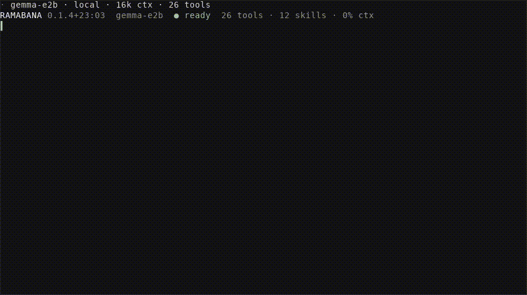

# ramabana


<!-- WARNING: THIS FILE WAS AUTOGENERATED! DO NOT EDIT! -->

<p align="center">


</p>

Ramabana runs a language model as a coding assistant. You describe a
task in plain words. The model searches the code, reads and edits files,
runs commands and Python, and tells you what it did. Ramabana runs that
loop, decides which tools the model may call, keeps every write inside
the folders you opened, and stops to ask you before anything changes.

The same agent runs in four places: a terminal session, an editor that
speaks the Agent Client Protocol, an MCP server that lends its tools to
another assistant, and your own Python program. Each of them builds the
same [`Agent`](https://vedicreader.github.io/ramabana/agent.html#agent)
over the same tools, so a behaviour you see in one appears in the
others.

Start with one folder. Ramabana writes only inside the folders that
`--root` names, and its reads stay inside them too unless you pass
`--read-outside`.

<p align="center">


</p>

## How the pieces fit

A few words recur on every page of these docs.

A turn is one prompt from you and everything the agent does to answer
it. During a turn Ramabana calls the model, runs the tools the model
asked for, sends back their results, and calls the model again. Each
round of one model call and its tool calls is a step. The turn ends when
the model answers without asking for a tool, or when it runs out of one
of its budgets.

A tool is a Python function the model may call. Its name, arguments and
docstring are what the model sees. Tools come in groups: code search,
files, notebooks, the web, memory, shell commands, git, Python, and a
few more. The toolset itself lives in
[shalya](https://github.com/vedicreader/shalya), and Ramabana imports
it.

A host is the object that gives the tools their reach into the world:
which folders they may read and write, whether the network is on, where
memory is kept, and which approval gate guards a write. A host lists the
groups it supports by inheriting one class per group, such as `CodeHost`
or `WebHost`, and the agent offers only the tools of those groups. The
terminal runs on shalya’s `LocalHost`. The tests run on an in-memory
host from `ramabana.testing`.

The approval gate sits between the model and any tool with an effect,
such as editing a file, running a command or making a git commit. In the
default mode it asks you about each one. The [Approvals](#approvals)
section lists the other modes.

The briefing is the system prompt Ramabana writes for each session. It
names the open folders, sets out how to work, lists the skills it found,
and adds the project’s own instructions from files such as `AGENTS.md`
and `CLAUDE.md` in each open folder.

A skill is a markdown file of guidance the agent reads only when the
work calls for it. The briefing lists each skill in one line and the
`read_skill` tool returns one in full.

A sub-agent is a second agent that the running one starts for a piece of
the work, through the
[`delegate`](https://vedicreader.github.io/ramabana/tools.html#delegate)
tools. It has its own steps and transcript, works under the same
approval gate, and reports back to the turn that started it.

A job is a kind of model call other than the turn itself, such as a
completion, a summary or a sub-agent. Ramabana routes each job to a
model suited to it, as [Point it at a model](#point-it-at-a-model)
explains.

## Install

Ramabana needs Python 3.12 or newer. The core package holds the agent,
its hosts, and the file, code, shell and git tools, which is enough to
build an agent into your own program. Each extra adds one way of using
it:

``` sh
pip install ramabana           # the core, to build an agent or an app on
pip install 'ramabana[cli]'    # the terminal session, with search and python
pip install 'ramabana[all]'    # every extra
```

<table>
<colgroup>
<col style="width: 50%" />
<col style="width: 50%" />
</colgroup>
<thead>
<tr>
<th>extra</th>
<th>adds</th>
</tr>
</thead>
<tbody>
<tr>
<td><code>[search]</code></td>
<td>semantic code search, the vault’s memory and watches, the web
tools</td>
</tr>
<tr>
<td><code>[python]</code></td>
<td>the Python prompt and <code>--attach</code>, on dhrishti</td>
</tr>
<tr>
<td><code>[serve]</code></td>
<td><code>ramabana-mcp</code> and <code>ramabana-acp</code></td>
</tr>
<tr>
<td><code>[dhrona]</code></td>
<td><code>--warm</code>, which starts a chat with example rounds from
dhrona</td>
</tr>
<tr>
<td><code>[cli]</code></td>
<td>the terminal session, plus <code>[search]</code> and
<code>[python]</code></td>
</tr>
</tbody>
</table>

A program that embeds Ramabana installs only the extras it needs, such
as `ramabana[search,serve]`. When an extra is missing, the tools that
need it are left out of what the model is offered, and any command that
needs it names the extra to install.

The core install already brings in the packages shalya depends on:
dhrishti, jupyter-client, fossick, litesearch and vishalakshi, which in
turn brings in mcp. The extras add the terminal, the two servers, the
Python prompt and the search pieces on top.

To use the terminal on its own, run `uv tool install 'ramabana[cli]'`
and then `ramabana`. The first interactive run starts inside a tmux
server that belongs to Ramabana. tmux is the terminal multiplexer that
splits one window into panes. Running inside it gives you the now pane,
a live view of what the agent is doing in a split beside the session,
and lets `shift+enter` queue a message, with no tmux setup on your part.
When tmux is missing, it offers the install command once.
`ramabana --doctor` checks tmux, extended keys, the config and
`ramabana-pane`. `--tmux off` or `RAMABANA_TMUX=off` keeps the session
in the terminal you started it in. Detaching or closing the window ends
the session, and `--resume latest` reopens it.

<table>
<colgroup>
<col style="width: 50%" />
<col style="width: 50%" />
</colgroup>
<thead>
<tr>
<th>command</th>
<th>what it is</th>
</tr>
</thead>
<tbody>
<tr>
<td><code>ramabana</code></td>
<td>the terminal session, drawn with teleprint. Needs
<code>[cli]</code></td>
</tr>
<tr>
<td><code>ramabana-mcp</code></td>
<td>the MCP server. Needs <code>[serve]</code></td>
</tr>
<tr>
<td><code>ramabana-acp</code></td>
<td>the Agent Client Protocol server an editor launches. Needs
<code>[serve]</code></td>
</tr>
<tr>
<td><code>ramabana --python</code></td>
<td>the Python prompt, with the kernel inspected through dhrishti. Needs
<code>[python]</code></td>
</tr>
<tr>
<td><code>ramabana-tick</code></td>
<td>one beat of the schedules, run on a timer by pobblebonk</td>
</tr>
</tbody>
</table>

## Point it at a model

`--model` names the model that this session’s turns run on, called the
turn model. Without it the turn model is `$RAMABANA_MODEL`, then
`$LEELA_MODEL`, then `claude-opus-5-5` through Claude Code. A turn runs
on this machine only when you name a local model.

``` sh
ramabana --root . --model sonnet
export RAMABANA_MODEL=sonnet    # the same choice in every session
```

<table>
<colgroup>
<col style="width: 33%" />
<col style="width: 33%" />
<col style="width: 33%" />
</colgroup>
<thead>
<tr>
<th>names</th>
<th>runs on</th>
<th>credential</th>
</tr>
</thead>
<tbody>
<tr>
<td><code>opus</code>, <code>sonnet</code>, <code>fable</code>,
<code>haiku</code>, <code>claude-opus-5-5</code>,
<code>claude-sonnet-5-5</code>, <code>claude-fable-5-1</code></td>
<td>Claude Code</td>
<td>a <code>claude /login</code> session</td>
</tr>
<tr>
<td><code>gpt</code>, <code>gpt-mini</code>, <code>gpt-sol</code>,
<code>gpt-5.6</code>, <code>gpt-4.1</code>,
<code>gpt-4.1-mini</code></td>
<td>the OpenAI API</td>
<td><code>OPENAI_API_KEY</code></td>
</tr>
<tr>
<td><code>gpt-6-luna</code>, <code>gpt-5.5</code>,
<code>gpt-5.3-codex-spark</code></td>
<td>Codex</td>
<td>a Codex login</td>
</tr>
<tr>
<td><code>anthropic/&lt;id&gt;</code></td>
<td>the Anthropic API</td>
<td><code>ANTHROPIC_API_KEY</code></td>
</tr>
<tr>
<td><code>copilot/&lt;id&gt;</code></td>
<td>GitHub Copilot</td>
<td>a Copilot sign-in</td>
</tr>
<tr>
<td><code>azure/&lt;deployment&gt;</code></td>
<td>Azure OpenAI, v1 API</td>
<td><code>AZURE_OPENAI_ENDPOINT</code> and
<code>AZURE_OPENAI_API_KEY</code></td>
</tr>
<tr>
<td><code>openrouter/&lt;vendor&gt;/&lt;model&gt;</code></td>
<td>OpenRouter</td>
<td><code>OPENROUTER_API_KEY</code></td>
</tr>
<tr>
<td><code>gemma-e2b</code>, <code>gemma-e4b</code>,
<code>gemma-12b</code></td>
<td>LiteRT, on the device</td>
<td>none</td>
</tr>
<tr>
<td><code>qwen-4b</code>, <code>mini-coder-4b</code>,
<code>ornith-9b</code></td>
<td>MLX, on Apple silicon</td>
<td>none</td>
</tr>
<tr>
<td><code>llama-qwen-0.6b</code>, <code>llama-qwen-1.7b</code>,
<code>llama-qwen-4b</code></td>
<td>llama.cpp, on the device</td>
<td>none</td>
</tr>
<tr>
<td><code>ollama/&lt;id&gt;</code></td>
<td>the ollama daemon</td>
<td>none</td>
</tr>
</tbody>
</table>

`/models` lists what this machine can reach and marks the one running.
`/model NAME` changes model without ending the session. `/model` alone
prints the routing summary.

Not every model call needs the turn model. Ramabana sorts the smaller
calls into jobs and sends each job to a cheaper or faster model.
Completions and classification run on `claude-haiku-5-5`. Inline edits,
summaries and other one-shot work run on `gpt-6-luna` through your Codex
login. Delegated sub-agents run on `claude-sonnet-5-5`. When the turn
model is local, every job without a model of its own stays on it. When a
job’s model cannot run, the job moves to another cloud route. Without a
Codex login, the default Luna jobs fall back to the turn model. A cloud
model whose one-shot answer fails or comes back empty is set aside for
five minutes, and its jobs move the same way. With no cloud route left,
a job runs on `gemma-e4b` on the device, and the turn never moves. The
session reports each fallback once. With nothing left at all, the error
names the job, the model and the key or CLI it needs.

`$RAMABANA_MODEL_<JOB>` overrides one job. `<JOB>` is `ONESHOT`,
`INLINE`, `COMPLETION`, `CLASSIFY`, `SUMMARY` or `SUBAGENT`. The turn
model uses `$RAMABANA_MODEL` and has no `_TURN` variable.
`/model JOB NAME` sets one job inside a session:

``` sh
export RAMABANA_MODEL_SUBAGENT=gpt-5.6-luna
```

## Settings for this machine

`~/.config/ramabana/config.toml` holds the settings you would otherwise
repeat in every shell: the model for each job, the window guard’s
numbers, compaction, learning, and the defaults of the terminal’s flags.
Every Ramabana on the machine reads it, including one inside Leela, an
editor or an MCP client. A flag beats an env var, an env var beats the
file, and the file beats the built-in default.

``` sh
ramabana config init    # write the file, every key commented out beside its default
ramabana config show    # each value in effect, and whether it came from an env var, the file or the default
```

``` toml
[jobs]
turn = "gpt-5.4"          # what $RAMABANA_MODEL and --model beat
subagent = "gpt-5.6-luna"

[window]
margin = 1.2              # charge estimated token counts 20% more

[model."openai/gpt-5.4"]  # correct a number fastllm's table has wrong
max_input_tokens = 272000

[model."claude-opus-5-5"] # a Claude Code turn silent this long is ended and tried once more
timeout = 300
```

An entry Ramabana cannot use is reported and takes its default; nothing
fails to start over it.

### Set up a provider

Ramabana chooses no provider for you. When the turn’s model cannot run
here, because Claude Code is missing or a key is not set, the terminal
prints the providers it can use, which are set up, and the model each
job runs on, then offers `ramabana setup`:

``` sh
ramabana setup                         # pick a provider, answer its questions, name the jobs it serves
ramabana setup --provider azure --model-id gpt-5.4 --endpoint https://NAME.openai.azure.com --jobs turn,summary
```

It writes a `[model."NAME"]` table and `[jobs]` lines into config.toml.
It never writes a key; export the env var it names.
`ramabana config show` prints what is in effect.

<table>
<colgroup>
<col style="width: 33%" />
<col style="width: 33%" />
<col style="width: 33%" />
</colgroup>
<thead>
<tr>
<th>provider</th>
<th>needs</th>
<th>name a model as</th>
</tr>
</thead>
<tbody>
<tr>
<td>OpenAI API</td>
<td><code>OPENAI_API_KEY</code></td>
<td><code>gpt-5.4</code></td>
</tr>
<tr>
<td>Azure OpenAI</td>
<td><code>AZURE_OPENAI_ENDPOINT</code>,
<code>AZURE_OPENAI_API_KEY</code></td>
<td><code>azure/&lt;deployment&gt;</code>, or a
<code>[model."NAME"]</code> table</td>
</tr>
<tr>
<td>AWS Bedrock</td>
<td><code>AWS_BEARER_TOKEN_BEDROCK</code>, a Bedrock API key</td>
<td>a <code>[model."NAME"]</code> table on the Mantle endpoint</td>
</tr>
<tr>
<td>Anthropic API</td>
<td><code>ANTHROPIC_API_KEY</code></td>
<td><code>anthropic/&lt;model&gt;</code></td>
</tr>
<tr>
<td>Gemini API</td>
<td><code>GEMINI_API_KEY</code></td>
<td><code>gemini/&lt;model&gt;</code></td>
</tr>
<tr>
<td>OpenRouter</td>
<td><code>OPENROUTER_API_KEY</code></td>
<td><code>openrouter/&lt;vendor&gt;/&lt;model&gt;</code></td>
</tr>
<tr>
<td>Claude Code, Codex, Copilot</td>
<td>a sign-in</td>
<td><code>claude-opus-5-5</code>, <code>gpt-6-luna</code>,
<code>copilot/&lt;model&gt;</code></td>
</tr>
<tr>
<td>any OpenAI-compatible server</td>
<td>its URL and an env var with its key</td>
<td>a <code>[model."NAME"]</code> table</td>
</tr>
<tr>
<td>this machine</td>
<td>a local runtime</td>
<td><code>gemma-e4b</code>, <code>qwen-4b</code>,
<code>ollama/&lt;model&gt;</code></td>
</tr>
</tbody>
</table>

Azure OpenAI, by hand:

``` toml
[azure]
endpoint = "https://NAME.openai.azure.com"   # or $AZURE_OPENAI_ENDPOINT; the key stays in $AZURE_OPENAI_API_KEY

[model."az-image"]                            # an Azure deployment of gpt-image-1, for generate_image
model_id = "gpt-image-1"
base_url = "https://NAME.openai.azure.com/openai/v1"

[jobs]
turn = "azure/gpt-5.4"                        # a deployment, named by its deployment name
completion = "azure/gpt-5.4-mini"
classify = "azure/gpt-5.4-mini"
image = "az-image"
video = "gemini/veo-3.0-generate-001"        # generate_video; or an Azure sora-2 [model."NAME"]

[model."azure/prod-chat"]                     # a deployment named for no known model needs its window
max_input_tokens = 200000
```

Requests go to `https://NAME.openai.azure.com/openai/v1/responses` with
the deployment name as the model; no `api-version` is needed. A
deployment named for a model, such as `gpt-5.4`, gets that model’s
window and briefing. Any other name runs with a 128k window until
`max_input_tokens` corrects it, and its cost reads as $0, because prices
are looked up by model name.

AWS Bedrock, by hand, through its OpenAI-compatible Mantle endpoint:

``` toml
[model."bedrock-gpt"]
model_id = "openai.gpt-5.4"                   # Bedrock's model id
base_url = "https://bedrock-mantle.us-east-1.api.aws/v1"
api_key_env = "AWS_BEARER_TOKEN_BEDROCK"      # a Bedrock API key; short-lived keys need renewing
api_name = "openai"                           # Responses; openai_chat for the models that offer only chat completions

[jobs]
turn = "bedrock-gpt"
```

Claude on Bedrock, and anything else that needs Bedrock’s native
Converse API, AWS profiles or SigV4 signing, is not supported yet:
fastllm, which makes the requests, implements none of them. The Mantle
endpoint has no images endpoint, so `generate_image` needs another
`[jobs] image`.

A `[model."NAME"]` table with `model_id` defines a hosted model of any
OpenAI-compatible kind under a name of your own: `model_id`, `base_url`,
`api_key_env` (the env var, never the key), `api_name` (`openai` for
Responses, `openai_chat` for chat completions; `openai` is the default
on an Azure host), `vendor_name`, `runtime` and `ctx`. Saved model
aliases live in `~/.config/ramabana/models.json` (Leela keeps its own in
`~/.config/leela/models.json`). Every Ramabana process loads them, and
config.toml’s definitions, on first use; a name defined in both places
is config.toml’s. A scheduled job, such as Dhrona’s nightly batch, sees
only the environment it was started with, so export the key there too.

A message too large for the window still goes out. A huge paste, a
screenshot too many or a giant tool result is cut to its head and its
end, the whole kept in a file under the session’s run folder, and the
note in its place tells the model where the file is and to read it in
pieces.

## Your first session

``` sh
ramabana --root .
```

This opens the current folder, asks before every write, and runs on the
default model. Type a task and press enter. `/help` prints the key card
and `/guide` the longer tour. `ctrl+c` stops a running turn and `ctrl+d`
quits.

Pass a prompt instead and Ramabana runs one turn, prints the answer on
stdout, and exits:

``` sh
ramabana --root . 'Find where request timeouts are configured.'
ramabana --root . 'Summarise the open TODOs' > todos.md
```

The one-turn form prints each problem on stderr and exits 1 when the
turn model was not up, so a script or a git hook can use it.

## The terminal, option by option

<table>
<colgroup>
<col style="width: 33%" />
<col style="width: 33%" />
<col style="width: 33%" />
</colgroup>
<thead>
<tr>
<th>option</th>
<th>default</th>
<th>what it does</th>
</tr>
</thead>
<tbody>
<tr>
<td><code>--root A,B</code></td>
<td><code>.</code></td>
<td>the folders it may read and write, comma separated</td>
</tr>
<tr>
<td><code>--model NAME</code></td>
<td>routing default</td>
<td>the model this session’s turns run on</td>
</tr>
<tr>
<td><code>--approve MODE</code></td>
<td><code>ask</code></td>
<td><code>ask</code>, <code>edits</code>, <code>auto</code>,
<code>off</code> or <code>none</code>. <code>edits</code> lets file and
notebook edits through and asks for the rest</td>
</tr>
<tr>
<td><code>--no-web</code></td>
<td>web on</td>
<td>takes the network away from the web tools</td>
</tr>
<tr>
<td><code>--read-outside</code></td>
<td>off</td>
<td>reads may name any path. Writes stay inside <code>--root</code></td>
</tr>
<tr>
<td><code>--no-subagent-writes</code></td>
<td>writes on</td>
<td>restrict delegated sub-agents to read-only tools</td>
</tr>
<tr>
<td><code>--vault</code></td>
<td>off</td>
<td>keeps what the agent reads in a vishalakshi vault</td>
</tr>
<tr>
<td><code>--pii MODE</code></td>
<td><code>off</code></td>
<td><code>redact</code> or <code>refuse</code> for what the vault hands
back</td>
</tr>
<tr>
<td><code>--pii-ner</code></td>
<td>off</td>
<td><code>--pii</code> gates titled names too, not only patterns</td>
</tr>
<tr>
<td><code>--spec</code></td>
<td>off</td>
<td>adds <code>api_load</code>, <code>api_ops</code> and
<code>api_call</code></td>
</tr>
<tr>
<td><code>--theme NAME</code></td>
<td><code>auto</code></td>
<td>the terminal palette</td>
</tr>
<tr>
<td><code>--max-tool-calls N</code></td>
<td><code>auto</code></td>
<td>20 to 400 tool calls per turn</td>
</tr>
<tr>
<td><code>--max-steps N</code></td>
<td><code>auto</code></td>
<td>8 to 80 steps per turn, each a model call and its tools</td>
</tr>
<tr>
<td><code>--cfg DIR</code></td>
<td><code>~/.config/ramabana</code></td>
<td>skills, extensions, history and plans</td>
</tr>
<tr>
<td><code>--resume ID</code></td>
<td>none</td>
<td>reopen a saved session by id, by prefix, or <code>latest</code></td>
</tr>
<tr>
<td><code>--python</code></td>
<td>off</td>
<td>start in Python mode, on a kernel of your own</td>
</tr>
<tr>
<td><code>--attach NAME</code></td>
<td>none</td>
<td>join a live Python session</td>
</tr>
<tr>
<td><code>--agent-proxy</code></td>
<td>off</td>
<td>expose this session’s agent inside its Python prompt</td>
</tr>
<tr>
<td><code>--kernels</code></td>
<td>off</td>
<td>list live Python sessions and exit</td>
</tr>
<tr>
<td><code>--json</code></td>
<td>off</td>
<td>with a prompt: reply, usage, changes, activity, problems and session
as JSON</td>
</tr>
<tr>
<td><code>--no-bell</code></td>
<td>bell on</td>
<td>no terminal bell when a turn ends or an approval waits</td>
</tr>
<tr>
<td><code>--tmux MODE</code></td>
<td><code>auto</code></td>
<td><code>on</code> or <code>off</code>: read the sibling panes and open
the side pane. <code>off</code>, like <code>RAMABANA_TMUX=off</code>,
also keeps the session out of ramabana’s own tmux</td>
</tr>
<tr>
<td><code>--pane MODE</code></td>
<td><code>auto</code></td>
<td><code>on</code> or <code>off</code>: the now pane at startup.
<code>auto</code> opens it only inside tmux</td>
</tr>
<tr>
<td><code>--doctor</code></td>
<td>off</td>
<td>check tmux and the now pane, offer to install tmux, and exit</td>
</tr>
<tr>
<td><code>--optin A,B</code></td>
<td>none</td>
<td>extra tool groups: <code>exhash</code> (the hash-addressed
<code>edit_file</code>), <code>research</code>, <code>author</code>,
<code>legacy</code></td>
</tr>
<tr>
<td><code>--warm</code> / <code>--no-warm</code></td>
<td>off</td>
<td>seed the chat with a few of dhrona’s example rounds
(<code>uv add "ramabana[dhrona]"</code>), or start empty. Off by
default: a model copies an example’s one call per message and its paths.
<code>--warm</code> gives the <code>small</code> profile one round</td>
</tr>
<tr>
<td><code>--profile P</code></td>
<td><code>auto</code></td>
<td><code>small</code> offers fourteen tools and a one-screen briefing.
<code>full</code> offers everything. <code>auto</code> picks
<code>small</code> for a local model or a window of 32k or less.
<code>/model</code> shows the active one. <code>small</code> leaves out
extension tools not marked with <a
href="https://vedicreader.github.io/ramabana/tools.html#small_tool"><code>ramabana.tools.small_tool</code></a></td>
</tr>
</tbody>
</table>

`--theme` takes `auto`, `github-dark`, `dark`, `light`, `gruvbox`,
`gruvbox-light`, `nord`, `tokyonight`, `catppuccin`, `latte`,
`everforest`, `dracula`, `kanagawa`, `solarized` or `solarized-light`.
`auto` is `github-dark`. Set your terminal to the scheme of the same
name and the two agree. `/theme NAME` switches mid-session and repaints
what is already on screen.

## Inside a session

Type `/` and press tab to complete a command. The list holds this
session’s commands, extensions included.

<table>
<colgroup>
<col style="width: 50%" />
<col style="width: 50%" />
</colgroup>
<thead>
<tr>
<th>command</th>
<th>what it does</th>
</tr>
</thead>
<tbody>
<tr>
<td><code>/help</code>, <code>/guide</code></td>
<td>the key card, then the longer tour</td>
</tr>
<tr>
<td><code>/model [JOB] [NAME]</code>, <code>/models [all]</code></td>
<td>the routing summary, a switch, or what this machine can reach</td>
</tr>
<tr>
<td><code>/sessions</code>, <code>/resume [ID\|latest]</code></td>
<td>the saved sessions, and reopening one</td>
</tr>
<tr>
<td><code>/plan</code>,
<code>/todo ID done\|active\|pending\|cancelled</code></td>
<td>the checklist the agent works through</td>
</tr>
<tr>
<td><code>/cost</code>, <code>/compact [NOTE]</code></td>
<td>what the session has spent, and shortening the history</td>
</tr>
<tr>
<td><code>/tool-budget [auto\|20..400]</code>,
<code>/steps [auto\|8..80]</code></td>
<td>the per-turn budgets, and what the last turn used</td>
</tr>
<tr>
<td><code>/approve [off\|ask\|edits\|auto]</code>,
<code>/subagents [on\|off\|steps N\|timeout S\|nest N]</code></td>
<td>who may write, whether delegates may, and their limits</td>
</tr>
<tr>
<td><code>/commit [FOLDER] [MESSAGE]</code>,
<code>/pr [FOLDER] [TITLE]</code></td>
<td>a commit or pull request drafted from the diff of the repository
holding FOLDER (default the project), behind approval</td>
</tr>
<tr>
<td><code>/rewind [TURN] [files\|chat\|both]</code>,
<code>/branches</code>, <code>/branch NAME</code></td>
<td>undo a turn’s files or chat, and the conversation branches. Undo
restores edits, undoes git writes, and removes created files still
unchanged</td>
</tr>
<tr>
<td><code>/watch [RUN\|monitors]</code>, <code>/unwatch</code>,
<code>/tell RUN TEXT</code></td>
<td>a tmux pane on a run’s transcript, and a message to a running
sub-agent</td>
</tr>
<tr>
<td><code>/pane</code>, <code>/pane off</code></td>
<td>the now pane in a tmux split, and closing it</td>
</tr>
<tr>
<td><code>/NAME ARGS</code>, <code>#note TEXT</code></td>
<td>run a skill, or <code>&lt;cfg&gt;/commands/NAME.md</code> as a turn
with <code>$ARGUMENTS</code>, <code>$1..$n</code> and <code>@path</code>
filled in. A repo’s <code>.agents/commands/</code> counts once
<code>project_extensions</code> is opted in. <code>#note</code> saves a
line to the next session’s memory</td>
</tr>
<tr>
<td><code>/root [add PATH]</code>, <code>/theme [NAME]</code>,
<code>/mouse</code></td>
<td>the open folders, the palette, and clicking blocks</td>
</tr>
<tr>
<td><code>/attach PATH</code>, <code>/detach [N]</code>,
<code>/paste</code>, <code>/copy [turn]</code></td>
<td>files and images in, text out</td>
</tr>
<tr>
<td><code>/skills</code>, <code>/skill NAME</code>, <code>/tools</code>,
<code>/extensions</code>, <code>/reload</code></td>
<td>what this session loaded, and loading it again</td>
</tr>
<tr>
<td><code>/python</code>, <code>/agent</code>, <code>/vars</code>,
<code>/promote NAME</code></td>
<td>the Python prompt and its namespace</td>
</tr>
<tr>
<td><code>/kernels</code>, <code>/join NAME</code>,
<code>/agent_proxy</code></td>
<td>live Python sessions</td>
</tr>
<tr>
<td><code>/stop [ID]</code>, <code>/runs [all]</code></td>
<td>the runs in flight</td>
</tr>
<tr>
<td><code>/quit</code>, <code>/exit</code></td>
<td>leave</td>
</tr>
</tbody>
</table>

The keys:

<table>
<colgroup>
<col style="width: 50%" />
<col style="width: 50%" />
</colgroup>
<thead>
<tr>
<th>key</th>
<th>what it does</th>
</tr>
</thead>
<tbody>
<tr>
<td><code>enter</code></td>
<td>send. Mid-turn it steers: the running turn gets the line after its
current tool call. A line with an <code>@path</code>, or sent with an
attachment, waits for the next turn. <code>tab</code> completes a
<code>/command</code> or an <code>@path</code></td>
</tr>
<tr>
<td><code>shift+enter</code></td>
<td>mid-turn, queue the line as the next turn. It needs tmux extended
keys, which ramabana’s own tmux has. Inside your tmux, ramabana turns
them on for that server when they are off</td>
</tr>
<tr>
<td><code>shift+tab</code></td>
<td>cycle approvals through <code>ask</code>, <code>edits</code> and
<code>auto</code>. The mode shows at the left of the row under the
bar</td>
</tr>
<tr>
<td><code>ctrl+t</code></td>
<td>show or hide the plan</td>
</tr>
<tr>
<td><code>ctrl+p</code>, <code>ctrl+n</code></td>
<td>walk the prompts you have sent</td>
</tr>
<tr>
<td><code>up</code>, <code>down</code>, <code>ctrl+r</code></td>
<td>browse the transcript. <code>pgup</code>, <code>pgdn</code>,
<code>/?</code> to search, <code>y</code> to copy a block,
<code>esc</code> to leave</td>
</tr>
<tr>
<td><code>ctrl+o</code></td>
<td>fold or open all the working of a turn</td>
</tr>
<tr>
<td><code>alt+1</code> to <code>alt+9</code></td>
<td>open one entry of it</td>
</tr>
<tr>
<td><code>ctrl+g</code></td>
<td>make approvals one step stricter</td>
</tr>
<tr>
<td><code>ctrl+v</code></td>
<td>attach an image from the clipboard</td>
</tr>
<tr>
<td><code>ctrl+c</code></td>
<td>stop the turn and drop queued lines and any steering the turn has
not taken yet. A second press terminates it, a third quits</td>
</tr>
<tr>
<td><code>ctrl+d</code></td>
<td>quit</td>
</tr>
</tbody>
</table>

A turn reads top to bottom: `┆` narration, `│` a tool call, then the
answer. To send a file or an image with the prompt, drop its path on the
terminal, write `@path` in the prompt, or use `/attach PATH`. `tab`
after `@` completes files and folders in the open folders, and from
`~/`, `/` or `../` when reading outside them is on. A folder attaches
its listing. Quote a path with spaces: `@"my notes/plan.md"`.

## Approvals

An approval gate guards the write tools. `--approve` sets its mode.

<table>
<thead>
<tr>
<th>mode</th>
<th>what happens</th>
</tr>
</thead>
<tbody>
<tr>
<td><code>ask</code></td>
<td>every write waits for you. The default</td>
</tr>
<tr>
<td><code>edits</code></td>
<td>file and notebook edits run; other writes wait</td>
</tr>
<tr>
<td><code>auto</code></td>
<td>writes run unattended for the rest of the process</td>
</tr>
<tr>
<td><code>off</code></td>
<td>the gate refuses every write</td>
</tr>
<tr>
<td><code>none</code></td>
<td>no gate at all</td>
</tr>
</tbody>
</table>

At an approval prompt:

- `y` approves.
- `n` refuses.
- `a` approves everything for the rest of the session.
- `ctrl+y` approves with a note.
- A typed reason and enter refuses with that reason.

`shift+tab` cycles `ask`, `edits`, `auto` and back to `ask`. From `off`
it comes back in at `ask`. `ctrl+g` moves one step stricter, from `auto`
to `edits` to `ask` to `off`, and never the other way. `/approve MODE`
moves in either direction and answers any prompt already waiting.

The gate covers every tool with an effect:

- files: `replace_text`, `create_file`, `edit_cell`, `add_cell`, and
  `edit_file` when `--optin exhash` offers it
- code: `run_python`, `run_shell`, `run_shell_bg`
- git: `git_commit`, `git_checkout`, `git_stash`, `git_remote`
- the rest: `memory_forget`, `create_skill`, `cancel_watch`, `add_root`,
  `cart_add`, `cart_remove`

Git goes through those tools. `run_shell` refuses
`git commit|push|pull|fetch|stash|switch|checkout` and names the tool to
use. Ramabana snapshots every git write so `/rewind` can undo it. When
the same gated call comes three times running, Ramabana asks you rather
than run or refuse it again, whatever the mode.

## The folders it can touch

`--root` is the file policy. Name every folder, comma separated:

``` sh
ramabana --root .,~/notes,/srv/app
```

Writes reach those folders and nowhere else. Reads start out in the same
folders. `--read-outside` widens reads to any path on the machine and
leaves writes where they were. `/root` prints the open folders, and
`/root add PATH` opens another mid-session for reading and writing.

A sub-agent is a second agent that the running one starts, through the
[`delegate`](https://vedicreader.github.io/ramabana/tools.html#delegate)
tools, to do one part of the work. Sub-agents may write, run commands
and run Python by default. Every write remains behind this session’s
approvals. `--no-subagent-writes` or `/subagents off` restricts them to
read-only tools. A read-only session refuses
`delegate_async(writes=True)`.

A sub-agent takes at most 60 steps and runs for at most 1800 seconds by
default. `/subagents steps N` and `/subagents timeout S` change those
limits. `timeout 0` removes the time limit. A delegation’s `max_steps`
stays within the session cap and has a floor of 60 steps unless the
session cap is lower. Two levels of sub-agents may delegate again by
default. `/subagents nest 0` disables nesting. A nested sub-agent gets
only `delegate_search`. The sub-agents under one turn share one
tool-call budget the size of the turn’s own. At most four run at once.

Every run keeps a transcript under `<cfg>/runs/<session>/`. Inside tmux:

- `/watch RUN` opens a pane that tails the transcript.
- `/watch monitors` tails the folder reviews.
- `/tell RUN TEXT` sends a running sub-agent a message. It gets the
  message with its next tool result.
- `read_terminal` reads the sibling panes.
- `run_shell_bg` logs to a file rather than opening a pane. The side
  pane’s Background rows show its output, and `p` on one follows it in a
  tmux pane.

`/pane` opens the now pane in a split on the right. It shows the turn,
the call it is on, and each sub-agent run with its own calls. The split
needs tmux 3.1 or later, and `--pane on` opens it at startup. Without
tmux, or with `--tmux off`, `/pane` prints the `ramabana-pane` command
to run in another terminal instead.

## Budgets, cost and history

A turn runs until the model stops calling tools. `--max-tool-calls` caps
the tool calls. `--max-steps` caps the steps, each one model call and
the tools it runs. Both take `auto` or a number: 20 to 400 calls, 8 to
80 steps. `/tool-budget` and `/steps` change them mid-session and print
what the last turn ran under.

`/cost` prints:

- the tokens in and out
- the cached share
- the reasoning tokens
- the spend, when the backend reports one

`/compact` summarises the history so far and carries on with the shorter
context. `/compact NOTE` tells the compactor what to keep.

Ramabana saves every session with a completed turn under `--cfg`, which
defaults to `~/.config/ramabana`. `/sessions` lists them with their turn
counts and models. `/resume ID` reopens one from a full id or a unique
prefix. From the shell:

``` sh
ramabana --root . --resume latest
```

A resumed session brings back its history and its plan. It prints on
stderr any other folder that session had open, and `/root add PATH`
opens it again.

## Python mode

`--python` starts a Jupyter kernel that belongs to you, with the agent
in the layer above it:

``` sh
ramabana --root . --python
```

Enter runs code that compiles, tab completes identifiers, and `ctrl+c`
interrupts the cell. `/agent` hands the line back to the model and
`/python` takes it again. The agent reads your namespace and writes only
to its own overlay. `/vars` shows what is in the namespace, and
`/promote NAME` moves one of the agent’s values into it.

Other terminals can share a live session. `ramabana --kernels` lists the
ones running, `--attach NAME` joins one from another terminal, and
`/join NAME` joins one from inside a session. `--agent-proxy` binds this
session’s agent where the Python prompt can reach it, behind a proxy
that restricts usage and callbacks.

## Memory, API specifications and a beat

`--vault` keeps what the agent reads in a
[vishalakshi](https://github.com/vedicreader/vishalakshi) vault, for the
next session to retrieve. `--pii redact` masks personal data on the way
back out of the vault. `--pii refuse` refuses the retrieval instead.
`--pii-ner` extends either mode to titled names, not only patterns.
Either mode needs `--vault`. Without it the command exits 2 rather than
ignore the flag. A `--python`, `--attach` or `--agent-proxy` session has
no vault-backed host, so it refuses `--vault`.

`--spec` adds `api_load`, `api_ops` and `api_call`. Point `api_load` at
an OpenAPI, Azure or Google Discovery document and the agent can call
the operations it describes.

Some work should happen on a timer even when no session is open. A
schedule is a callback that pobblebonk fires at set times. A package
registers one under the `ramabana.ticks` entry point, as dhrona does,
and Python code registers one with `ramabana.monitor.on_tick(name)`. A
beat is one pass that runs every schedule that has come due.
`ramabana-tick` runs one beat and leaves what the schedules found as
notes, which the next session reads. `--install` hands the command to
cron, launchd or `schtasks`, so beats keep firing while no session is
open:

``` sh
ramabana-tick --install --every 300    # a beat every five minutes
ramabana-tick                          # one beat now
ramabana-tick --uninstall
```

## Skills and extensions

A skill is markdown the agent reads when the work calls for it. Ramabana
looks for skills in these folders, in order:

- `<cfg>/learned/skills`
- `<cfg>/skills`
- `~/.agents/skills`
- `.leela/skills` and `.agents/skills` under each open folder

When two skills share a name, the later folder wins. In each folder, a
skill is a subfolder holding a `SKILL.md`. Five skills ship inside the
package as Python modules: `coding_patterns`, `debugging`, `theory`,
`write_prose` and `write_docs`. Any folder above overrides them.
`/skills` lists what this session found, and `/skill NAME` prints one.

`<cfg>/learned` holds what dhrona, a separate package that learns from
past sessions, kept from earlier ones. Its skills override the packaged
ones and lose to every folder you write. Its `AGENTS.md` goes in the
briefing after Ramabana’s own rules and before the project instructions,
and the project instructions outrank it. A learned skill is listed like
any other and read when a task needs it; one that replaces an inlined
skill is clipped in the briefing to the same cap as `AGENTS.md`. Nothing
Dhrona proposes reaches a session until you accept it: each proposal
waits on a `pending/` branch of the folder’s own git repository.
`/learned` in a session, or `ramabana-learned` from a shell, lists them,
and `diff ID`, `accept ID` and `reject ID` act on one. An accept that
would take `AGENTS.md` past the 2,000 characters Dhrona allows is
refused. `/learned compact ID` then asks Dhrona to merge and shorten the
paragraphs it wrote with that proposal folded in, keeping yours as they
are, and the shorter file waits for review like any proposal. Accepting
a proposal moves the others onto it, and one that no longer applies is
marked stale; [`ramabana.learned`](21_learned.ipynb) offers the same to
a host. `--no-learned` starts a session without the folder.
`/learned off`, or `ramabana-learned off`, turns learning off for every
session on this machine, as `learning = false` in config.toml: nothing
learned is briefed, no lessons are kept or read, and the nightly batch
does nothing until `/learned on`.

An extension adds behaviour without changing Ramabana. It is a Python
file in `<cfg>/extensions` with a `setup(reg)` function, and through
`reg` it can:

- add a tool
- add a slash command
- register a skill
- hook the turn
- replace the approval policy

``` python
def setup(reg):
    @reg.tool
    def deploy_status() -> str:
        "What is deployed right now."
        return open('/var/run/deploy').read()

    reg.command('deploys', lambda agent, arg: deploy_status(), help='what is deployed')
    reg.on('after_tool', lambda agent, name, out: print(name, file=open('/tmp/tools.log', 'a')))
```

The hook events are `before_turn(agent, prompt)`,
`after_turn(agent, text)`, `before_tool(agent, name, args)`,
`after_tool(agent, name, out)`, `compact(agent, text)` and `approval`.
`reg.approval(fn)` replaces the approval policy, and the last
registration wins. `/extensions` prints one line per extension: loaded,
or why not. `/reload` loads skills, extensions and tools again after an
edit.

## Serve the tools to another assistant

`ramabana-mcp` serves one host’s tools over MCP:

``` sh
ramabana-mcp --root .
```

By default the server mounts only the read tools, because the client
cannot reach this process’s approval gate. `--write` mounts the write
tools too. `--model NAME` adds one further tool, `ask`, which runs a
whole Ramabana turn and returns only its answer. `--model` also builds
the agent. The mounted tools are then the same objects a turn gets, and
they record into the same activity log. The server offers skills as
resources rather than tools: an index, plus one per skill. A client
lists them and fetches the one it needs.

<table>
<thead>
<tr>
<th>option</th>
<th>default</th>
<th>what it does</th>
</tr>
</thead>
<tbody>
<tr>
<td><code>--root A,B</code></td>
<td><code>.</code></td>
<td>the folders to serve</td>
</tr>
<tr>
<td><code>--model NAME</code></td>
<td>none</td>
<td>adds the <code>ask</code> tool, running on this model</td>
</tr>
<tr>
<td><code>--write</code></td>
<td>off</td>
<td>mount the write tools too</td>
</tr>
<tr>
<td><code>--no-web</code></td>
<td>web on</td>
<td>takes the network away from the web tools</td>
</tr>
<tr>
<td><code>--read-outside</code></td>
<td>off</td>
<td>reads may name any path. Writes stay inside</td>
</tr>
<tr>
<td><code>--vault</code>, <code>--pii MODE</code>,
<code>--pii-ner</code></td>
<td>off</td>
<td>as in the terminal</td>
</tr>
<tr>
<td><code>--transport NAME</code></td>
<td><code>stdio</code></td>
<td><code>stdio</code>, <code>sse</code> or
<code>streamable-http</code></td>
</tr>
<tr>
<td><code>--cfg DIR</code></td>
<td>none</td>
<td>skills and extensions, with <code>--model</code></td>
</tr>
</tbody>
</table>

A model-less server still finds skills in the served folders and in
`~/.agents/skills`. The server loads `--cfg` and its extensions only
when `--model` builds the agent.

A client that launches its own servers takes the command:

``` json
{"mcpServers": {"ramabana": {"command": "ramabana-mcp", "args": ["--root", "/srv/app"]}}}
```

## Run it inside an editor

`ramabana-acp` speaks the [Agent Client
Protocol](https://agentclientprotocol.com/). An editor launches it and
drives it against the editor’s own files and terminal.

Zed takes agents from `agent_servers` in `settings.json`:

``` json
{"agent_servers": {"Ramabana": {"command": "ramabana-acp", "args": ["--root", "."]}}}
```

The editor names the folder. `--root` here is the fallback for a client
that names none. Approvals arrive as the editor’s own permission prompt.
`--model`, `--no-web`, `--vault`, `--pii`, `--pii-ner` and `--cfg` work
as they do in the terminal.

## Drive it from Python

[`ramabana.agent.mk_agent`](https://vedicreader.github.io/ramabana/agent.html#mk_agent)
builds what the terminal runs: a host over the folders you name, and an
[`Agent`](https://vedicreader.github.io/ramabana/agent.html#agent) whose
approval gate works the way `approve` says. `agent.ask(prompt)` runs one
turn and returns the answer.

The example below goes through the same
[`Agent.ask`](https://vedicreader.github.io/ramabana/agent.html#agent.ask)
path with
[`fake_agent`](https://vedicreader.github.io/ramabana/testing.html#fake_agent)
from `ramabana.testing`. Instead of a real model it uses a backend that
returns the replies you give it, and instead of your disk it uses a
small in-memory project, so it needs no credentials or downloads and
writes nothing.

A long-running program, such as a web app that runs agent jobs, uses the
same calls with these options:

- Read roots: `mk_agent(read_roots=[...])` opens folders that the read
  tools search and no write touches. The system prompt names them.
- Many asks: an ask is one approval request waiting for an answer.
  [`Approvals`](https://vedicreader.github.io/ramabana/agent.html#approvals)
  holds every waiting ask. `answer(id, ok)` resolves any of them, and
  `waiting` lists them oldest first. Each ask appears through
  `on_activity` as an `awaiting` row with its `ask_id` before its call
  runs.
- A policy: `Approvals(policy=fn)` is consulted before rules and modes.
  `fn(name, args)` returns `'allow'`, `'deny'`, `'ask'` or `None`.
- Waiting and timeouts: `no_listener='wait'` holds an ask until a page
  listens, and that page is shown the asks already waiting.
  `on_timeout='allow'` lets an unanswered ask through, except one that
  the policy or the loop guard put to a person.
- A typed result: `agent.ask(prompt, schema=Model)` returns a
  [`TurnResult`](https://vedicreader.github.io/ramabana/agent.html#turnresult)
  whose `result` is a validated `Model`.
- Sessions: `Agent(session_id=...)` names the session. A turn in a
  session another live process holds raises
  [`SessionBusy`](https://vedicreader.github.io/ramabana/agent.html#sessionbusy).
- Budgets: `max_cost`, `max_tokens`, `session_max_cost` and
  `session_max_tokens` stop a turn that passes them. The turn is
  recorded with state `budget`.
- An event file: `agent.events_to(path)` writes one JSON line per call,
  ask, plan change, turn start and end, and steering delivered. A file
  past `max_bytes` rolls over to `<name>.1`.
- A queue: `agent.queue(prompt)` holds a prompt, and
  `agent.run_queued()` runs what is held, in order. Steering a turn
  never read joins the next turn.
- A full resume: `resume_session(id, full=True)` restores the
  conversation as its last turn left it, every tool result whole. A stop
  that leaves a backend running hands its conversation to the next one.
- Defaults for a host: `mk_agent(python='off')` withholds Python, or a
  Dhrishti URL runs it in that kernel. `mk_agent(global_skills=False)`
  leaves `~/.agents/skills` out. `rules_path=` names the job’s own rules
  file. `Agent(extra_sp=...)` adds to the briefing.
- A worktree: `host.add_worktree(repo, branch)` makes a git worktree for
  the job and opens it as a root.
- A control socket: `ramabana.control.Control(agent).start()` listens on
  a socket in the session’s run folder, and
  `control_call(path, method, ...)` prompts, steers, cancels and answers
  it from another process.

`examples/embed_host.py` runs one such job end to end.

``` python
from ramabana.testing import fake_agent

agent, backend = fake_agent(replies=['The threshold is defined in `pkg/sizes.py`.'])
answer = agent.ask('Where is the threshold defined?')
answer
```

    'The threshold is defined in `pkg/sizes.py`.'

``` python
assert answer == 'The threshold is defined in `pkg/sizes.py`.'
assert agent.history[-1]['prompt'] == 'Where is the threshold defined?'

agent.turn_lines(), repr(agent.turn_use)
```

    (['🔍 Search Where is the threshold defined?'],
     '15 tok · in 10 · out 5 · model')

## Read the implementation

Start with the page for the contract you need:

- [core](00_core.ipynb): errors, routing, model budgets, and shared
  values
- [models](01b_models.ipynb): the model catalog, curated and discovered
- [runtime](01_runtime.ipynb): backends, usage, runs, and compaction
- [tools](02_tools.ipynb): hosts, tool construction, and delegation
- [agent](03_agent.ipynb): turns, approvals, activity, plans, history,
  and branching
- [testing](04_testing.ipynb): in-memory hosts and deterministic
  backends
- [terminal](05_cli.ipynb), [MCP](06_mcp.ipynb),
  [PyREPL](11_pyrepl.ipynb), and [ACP](16_acp.ipynb): frontend adapters,
  the [now pane](18_pane.ipynb) beside the terminal, and the [first-run
  setup](19_setup.ipynb) that starts it in tmux
- [vault](07_vault.ipynb), [API specifications](10_spec.ipynb), and
  [folder monitoring](17_monitor.ipynb): optional capabilities
- [control](20_control.ipynb): a local socket a detached job runner
  listens on
- [learned](21_learned.ipynb): the review queue for what Dhrona proposes
  for the learned folder
- [shop](08_shop.ipynb): product search tools
- [coding patterns](09_coding_patterns.ipynb),
  [debugging](22_debugging.ipynb), [theory](13_theory.ipynb),
  [prose](14_write_prose.ipynb), and
  [documentation](15_write_docs.ipynb): bundled agent skills

The toolset itself is [shalya](https://github.com/vedicreader/shalya),
the git plumbing is [gheasy](https://github.com/vedicreader/gheasy), and
the scheduler is
[pobblebonk](https://github.com/vedicreader/pobblebonk).

## Develop Ramabana

The notebooks are the source. nbdev generates every module under
`ramabana/`, and this page too.

``` sh
uv sync --all-extras --group dev
uv run nbdev-prepare    # export, test the notebooks, clean them, rebuild the README
uv run pytest           # the plain-python suite
```

Edit `nbs/*.ipynb`, never the exported `.py`.
